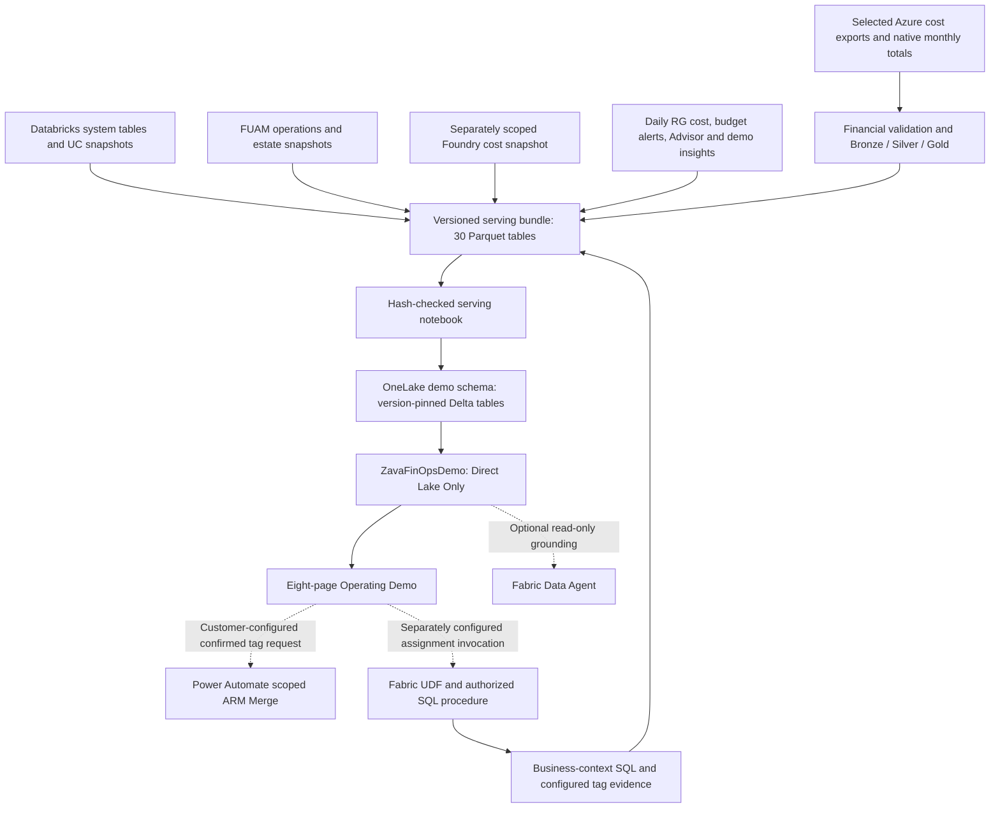

# Enterprise FinOps Observability and Governance Architecture

## 1. Decision and Scope

**Last implementation review:** 2026-10-23. **Original research baseline:** 2026-09-09.
**Status:** Implemented development POC with a broader production reference design. This document describes the current repository; it does not certify production readiness or authorize cloud changes.

The POC implements a customer-isolated Fabric financial and operational data platform with a Direct Lake semantic model and eight-page Power BI experience. Its implemented financial adapter reads selected Azure Cost Management exports directly. FinOps Hub is an optional upstream integration to evaluate, not a deployed dependency. Source-native operational telemetry remains separate from financial charges.

Each customer owns its deployment, identities, data, network boundaries, encryption configuration, and operational approvals. The reusable POC supplies adapters, contracts, transformation rules, tests, model/report definitions, and setup instructions. Customer configuration is separate from release code. No cross-customer financial or employee data collection is required.

Initial assumptions to confirm: commercial-cloud deployment; EA and/or MCA Azure billing; Unity Catalog-enabled Databricks; access to M365 licensing/procurement records; approved telemetry collection. Sovereign-cloud and regional differences are onboarding gates, not assumed parity.

### Current Implementation and Boundaries

| Area | Implemented in this repository | Not yet established for customer production |
| --- | --- | --- |
| Financial foundation | Separate ActualCost 2021-10-01 and FOCUS 1.0r2 adapters, selected export generations, SHA-256 checks, exact Decimal arithmetic, monthly native-query reconciliation, and versioned Bronze/Silver/Gold artifacts | Generalized automated collection, invoice certification, multi-currency accounting, and enterprise export-schema compatibility |
| Operational evidence | Bounded Databricks usage/query/warehouse extraction, Unity Catalog inventory, retained Fabric FUAM operations and estate snapshots | Unattended collection, aligned cross-platform coverage, complete job/run attribution, or real-time ingestion |
| Foundry | Daily cost-meter ledger from a separately scoped workbook-derived snapshot; Models/Tools and meter-family analysis | Requests, token quantities, latency, quality, PTU utilization, or per-agent cost attribution |
| Anomalies and insights | Daily RG cost comparison, retained Cost Management alerts and Advisor recommendations, plus seeded demonstration insights | A replica of Azure's proprietary anomaly detector, validated savings estimates, or production notification/remediation orchestration |
| Serving and experience | 30 versioned serving tables, a 30-table / 24-relationship / 69-measure Direct Lake model, and eight PBIR pages | Production RLS/OLS acceptance, certified chargeback, and customer-scale performance/availability qualification |
| Governed action | SQL assignment procedure and Fabric UDF; report controls and Power Automate flow bindings; scoped ARM tag Merge helper | Automatically provisioned customer flow/connections, broadly authorized resource actions, SKU changes, or shutdown automation |
| Planning and agent | Three-month trailing-mean forecast with three retrospective holdouts; report launch links for a read-only Fabric Data Agent | Seasonal forecasting, calibrated intervals, automatic customer agent provisioning, or qualification of every new table in the agent |
| Customer deployment | Sample build, local TMDL/PBIR rebinding, OneLake upload, serving notebook execution, model update/refresh request, and report update | Fresh-environment provisioning, fully verified refresh completion, end-to-end DAX acceptance, safe automatic rollback, or idempotent cloud replay |

The original demonstration used retained customer-environment snapshots; the public repository excludes raw local data and includes synthetic sample generators. Sample row counts and amounts are not acceptance targets for customer data. The separate Foundry subscription example must not be added to the main financial ledger total.

### Implemented Data Flow



Dashed paths require customer-specific connection, identity, and invocation configuration. A generated report button or flow ID is not proof that a backend is deployed or authorized. Source observations use different retained windows; no shared-time or dollar-allocation equivalence is implied.

### Repository and Deployment Contract

- Financial transformation and bundle validation: `scripts/finops_foundation.py`, `scripts/prepare_foundation_bundle.py`, and `scripts/run_foundation_fabric.py`.
- Operational extraction and serving: `scripts/databricks_medallion.py` and `scripts/demo_serving.py`.
- Model and report: `cloud-dev/ZavaFinOpsDemo.SemanticModel`, `cloud-dev/ZavaFinOpsOperatingDemo.Report`, and `scripts/build_operating_demo.mjs`. The root two-page Import PBIP is a separate earlier prototype.
- Customer settings: copy `config/customer.template.json` to git-ignored `config/customer.local.json`, or use the documented environment variables. Python configuration also reads `.env`; the standalone Node report builder uses its explicit JSON argument and process environment.
- Deployment helper: `scripts/deploy_customer_dev.py` updates an **existing** workspace, schema-enabled lakehouse, notebook, semantic model, and report. Required item IDs and access must already exist. It does not provision capacity, SQL/UDF resources, Power Automate flows, or a Data Agent.
- `--mode sample --dry-run` makes no cloud deployment calls, but builds data and rewrites local TMDL/PBIR files. It is not a no-write preview. Persist bundles with `--output-dir` when needed; the default temporary output is removed on exit.
- The live builder still assumes specific local snapshot paths and historical windows. It can silently select synthetic inputs when required financial or Databricks files are absent, and can reuse a cached supporting snapshot. A successful command therefore does **not** establish live-data completeness or sample/live isolation.
- Materialization rejects existing serving-version tables. The deployment helper's job polling can fall through without an explicit timeout failure; it requests a model refresh without checking completion or executing DAX acceptance. Verify notebook receipts, all table contents, refresh status, and report measures independently before accepting a deployment.

See [Customer Setup Guide](customer-setup-guide.md) for setup and [Security Policy](../SECURITY.md) for intended identity boundaries. The remaining sections describe production requirements and candidate integrations unless explicitly marked as current POC behavior. Product references retain their original research context and require revalidation before adoption.

## 2. Non-Negotiable Principles

1. **Financial authority:** Provider invoices and reconciled cost exports establish financial cost. An open-period export is provisional until reconciled, not an immutable invoice.
2. **Three records:** Financial cost, measured consumption, and allocated cost are separate facts. Estimated list-price cost is a fourth analytical view, never an additional charge.
3. **No double counting:** A charge enters the financial ledger once. CU allocations, DBU estimates, and token estimates explain the charge rather than increasing it.
4. **Visible uncertainty:** Every measure has a cost basis, currency, period, coverage, freshness, source, and confidence. Unknown is not zero.
5. **FOCUS for financial semantics:** Preserve the provider's FOCUS version and extensions. Keep operational telemetry in typed platform facts; do not force every operation into a billing row.
6. **Governance outside the report:** Power BI exposes investigations and action status. Independently authorized services enforce controls.
7. **Collect before history expires:** Many telemetry sources have short retention, no backfill, or best-effort delivery. Durable capture starts before historical allocation is promised.
8. **Read-only first:** Begin with showback and recommendations. Chargeback requires finance approval; disruptive execution requires an approved policy and operational safeguards.

## 3. Financial Foundation Decision

| Option | Value | Cost / limitation | Decision |
| --- | --- | --- | --- |
| FinOps Hub + Fabric | Reuses Azure export orchestration, FOCUS-oriented normalization, storage conventions, KQL interfaces, and Toolkit reporting/recommendations | Azure Data Factory and staging storage remain dependencies; Hub and adapter upgrades need compatibility tests; does not supply all platform telemetry | Optional integration; evaluate fit, support, and operating cost before adoption |
| Cost Management exports directly into Fabric | Fewer platform components; all custom transformations in Fabric | Team owns export completion, reruns, correction handling, compatibility, and operational support | Implemented POC path using selected retained exports; unattended collection remains work |
| Existing enterprise cost system feeding Fabric | Reuses an established finance process | Requires granular export rights, lineage, negotiated-cost visibility, timely corrections, and independent reconciliation | Prefer when an existing reconciled foundation already meets requirements |

### What Hub provides

Current Microsoft documentation describes ADLS Gen2 staging, Azure Data Factory ingestion/cleanup, optional Azure Data Explorer or Fabric Real-Time Intelligence storage, FOCUS alignment, multi-scope cost analysis, commitment-discount analysis, and Toolkit reports. Relevant datasets include costs, prices, reservation usage, transactions, and recommendations. ARG-based recommendation collection is available with the documented analytics configuration. Scope and export-version compatibility remain explicit constraints. [S01] [S02]

### What the POC and Customer Implementation Still Own

- Databricks detailed usage and execution metadata; Fabric operations and capacity history; Foundry deployment/application usage; M365 license and adoption data.
- Business-unit and application ownership history, contract imports, reporting currency, business outcome denominators, allocation policies, budget versions, and accounting close controls.
- Cross-platform identity resolution, data-quality and reconciliation controls, forecasts, workload comparisons, evidence-based recommendations, approval workflow, and verified savings.
- Enterprise access segregation, privacy, customer configuration, deployment lifecycle, and connector support.

### Integration choice and exit gate

For enterprise scale, evaluate Hub's documented Fabric RTI integration first. Use an Eventhouse/KQL database for the Hub analytics interface, not a second dedicated ADX cluster by default. If the customer already operates ADX, reuse it only when justified by network, cost, and operational ownership.

Consume **versioned public Hub functions**, such as the versioned Costs function available in the selected release. Do not bind production transformations to private Ingestion tables or an unversioned function whose schema can change. Preserve raw exports and their manifests in customer storage. Materialize reconciled financial batches into the OneLake medallion model through a bounded KQL extraction/Copy adapter. The pilot must prove pagination/result limits, stable snapshot semantics, replacement of changed periods, and throughput. A KQL function is not automatically a Direct Lake table. [S02]

An alternative Hub adapter reads completed Parquet datasets from the ingestion container through an ADLS shortcut under Lakehouse Files, then normalizes them into Delta. Storage datasets can have mixed schemas and are not necessarily already canonical FOCUS. Microsoft discourages storage-based analytics for larger estates; benchmark this path before using it as the enterprise default. A Files shortcut over Parquet does not by itself create a Direct Lake-ready table. [S02]

Choose one authoritative feed per financial scope, dataset, and period. Never load the same costs through both the Hub interface and the original exports into additive facts. Keep Hub upstream modules/pipelines unmodified; add isolated adapters. Pin Hub release, export dataset version, public function version, and transformation contract version together.

**Adoption gates:** Supported billing scopes and agreement types; invoice reconciliation; correction/replay correctness; extraction throughput; network/security support; upgrade compatibility; support ownership; and measured all-in operating cost. Hub is selected only after these pass. Rejecting Hub must not change the downstream financial contract.

Current Hub documentation excludes MOSA from the FOCUS-dependent v0.2+ path. Do not downgrade to the legacy v0.1.1 release to bypass this constraint. Assess agreement transition or a separately supported financial adapter. CSP/export-scope and sovereign-cloud support also need explicit validation. For EA/MCA, price and reservation data availability can depend on selecting EA billing-account or MCA billing-profile scope rather than subscription-only exports. [S01] [S02]

## 4. Logical Architecture

```text
CUSTOMER-OWNED SOURCES
  Azure Cost Management exports -> direct adapter OR evaluated FinOps Hub adapter
  Procurement / invoices / M365 contracts -> finance adapter
  ARG / Advisor / tags / organization registry -> metadata adapters
  Fabric capacity overview + operation events -> Eventstream
  Databricks system tables -> bounded SQL extraction / customer export job
  Foundry metrics + approved application telemetry -> telemetry adapters
  Graph Copilot usage + license assignment snapshots -> M365 adapters
                              |
                              v
INGESTION AND CONTROL
  Immutable source payloads, manifests, checkpoints, schema registry
  Optional hot Eventhouse for capacity and operational investigation
                              |
                              v
FABRIC ONELAKE
  Bronze: source evidence and technical lineage
  Silver: financial ledger, consumption, identity, metadata, quality
  Gold: financial and allocation facts, budgets, forecasts, unit economics
                              |
                              v
ENTERPRISE FINOPS SEMANTIC MODEL -> POWER BI OPERATING VIEWS
                              |
                 findings / policies / approved action requests
                              v
ALERTS AND ACTION SERVICES
  Activator / Azure Monitor / workflow -> approval -> scoped executor
                              |
                              v
  Audit trail, verification, rollback, and realized-savings feedback
```

The financial lane is batch-oriented. The operational lane can be near real time. Do not wait for a Power BI refresh or delayed billing export to protect a production endpoint from abnormal usage.

Separate dev/test/prod deployments. Within each environment, prefer a schema-enabled engineering lakehouse with `bronze`, `silver`, and `gold` schemas, and a separate restricted telemetry workspace where employee-sensitive evidence or hot Eventhouse data requires a distinct access boundary. Publish certified Gold products and semantic models to a consumer workspace. Schema names are organization, not an assumed security boundary. Validate supported OneLake access controls; split physical lakehouses/workspaces if the required isolation cannot be proven.

For production, isolate FinOps monitoring capacity from the workloads it monitors when the availability requirement justifies it. Native Azure Monitor and gateway protections remain operational if Fabric is delayed or unavailable. Include FinOps' own Fabric, ADF, storage, event ingestion, logging, gateway, and licensing charges in its operating cost.

## 5. Source Contracts

Cadences below are design targets, not source SLAs. Store both source-effective and ingestion times. All connectors need scoped identity, pagination, retry/backoff, durable checkpoints, schema validation, replay, and an explicit owner.

### 5.1 Azure and Common Financial Layer

| Source | Capture and grain | Ingestion and reconciliation |
| --- | --- | --- |
| Cost Management exports / Hub | Provider financial line, export scope, charge period, billing period, currency, resource, SKU/meter, charge category, billed/effective/list/contracted measures as available | Daily completed export batches; retain manifest and version; refresh changed open periods and process later adjustments |
| EA / MCA hierarchy | EA enrollment/account/department or MCA billing account/profile/invoice section, subscription links | Effective-dated registry; choose nonoverlapping authoritative export scopes; subscription Reader is not a substitute for billing-scope permission |
| Resource Graph and resource APIs | Resource ID, type, location, subscription, resource group, tags, SKU and state where exposed | Daily snapshots plus change events where useful; retain deleted resources and historical tags |
| Azure Advisor / Hub recommendations | Recommendation ID, resource, category, benefit estimate, observation time, status | Daily snapshots; deduplicate Hub and direct feeds; estimated savings are not additive across conflicting actions |
| Commitments and price sheets | Reservation/savings-plan benefit ID, term, purchase, utilization, coverage, applicable contract price | Use supported Cost Management benefit and price datasets/APIs; validate agreement support; preserve unused commitment cost |
| Finance and procurement | M365 invoice lines, seat commitments, contract terms, discounts, renewals, tax/credit policies, FX and business mapping | Governed monthly import with source document identity and finance approval; billing exports are not assumed to include every SaaS invoice |

Resource classification must distinguish **billed service** from **business workload**. A Databricks pipeline calling Foundry can have compute billed to Databricks and inference billed to Foundry, while both charges belong to one business workload. The four-platform view is a classification of selected financial lines, not a sum of independently calculated platform totals.

### 5.2 Microsoft Fabric

**Current POC:** Fabric observations come from retained FUAM daily operations and inventory snapshots, not an Eventstream/Eventhouse deployment. Source `TotalCUs` is retained as observed usage; it is not inferred CPU utilization or billed dollars.

**Production candidate:** Evaluate **capacity overview events** and **capacity operation events** for automated consumption collection. Overview provides 30-second smoothed CU windows, workload breakdowns, base capacity, carryforward, and throttling-related state. Operation events document capacity/workspace/item IDs, operation ID, CU milliseconds, duration, delay, status, utilization/release type, domain, and identity fields. Route supported events through Eventstream to durable storage and an Eventhouse when hot investigation is required. [S03] [S04]

Availability and unattended subscription ownership are pilot gates. The linked generic subscription-permissions page does not explicitly list these capacity event types. Do not infer service-principal support or the exact minimum role from permissions for unrelated Fabric event groups. That page documents ongoing owner permission checks and paused delivery after permission loss, with up to 24 hours retained while paused; this is not a general historical backfill guarantee. Validate owner rotation, least privilege and recovery for the selected event types. [S16]

Critical semantics:

- Convert CU milliseconds to CU seconds once. Overview utilization is CU milliseconds divided by `baseCapacityUnits * 1000 * windowSeconds`; do not divide again by operation duration.
- **Do not add overview and operation consumption together.** Overview is for capacity health; operations support attribution. Their timing differs because of smoothing.
- Deduplicate envelope events by source and event ID. For summary windows, enforce one record per tenant/capacity/window, retain conflicting payloads for investigation, and version the survivor rule.
- Operation identifiers and workload-native query/run identifiers are not universally interchangeable. Use verified joins; mark time-overlap correlation as inferred.
- Overview delivery is documented as best effort, may duplicate or miss events, and does not backfill. Paused capacities and all-zero windows may emit nothing. Missing windows cannot automatically become zero consumption. Capture starts at onboarding. [S03]
- Pausing can crystallize smoothed consumption into a large window. Preserve it and annotate state; do not silently delete financial evidence as an outlier. Separate raw operation consumption, smoothed utilization, and billed/allocated cost.
- Exclude unbilled preview usage from production cost-allocation weights unless finance explicitly chooses a separate hypothetical scenario. Validate release-type mappings against the deployed schema.
- Capacity IDs can persist across resize and pause/resume. Maintain SKU/state and workspace assignment history. Paid commitments may continue while compute is paused.
- The Capacity Metrics and Chargeback apps are reference experiences and manual validation tools. Both expressly prohibit external consumption/modification of their semantic models. No scheduled DAX/XMLA scraping of these models is part of this design. Exported visuals are bounded/manual evidence and may be sampled or limited. [S05] [S06]

| Fabric workload | Additional evidence and attribution | Important limit |
| --- | --- | --- |
| Spark, notebooks, Spark job definitions | Job/run history and approved Spark diagnostic logs; correlate to capacity operation and item | Duration, cores, or runtime alone are not CU billing records |
| Pipelines / Dataflows | Activity/run status, duration, copy volumes when exposed; capacity operations | Distinguish orchestration cost from downstream notebook/warehouse cost |
| Warehouses / SQL endpoints | Query Insights and supported monitoring logs for request performance; operation CU for item attribution | Validate retention and supported join keys; query-level cost can be a shared-cost estimate |
| Semantic models / Direct Lake | Query/refresh events, model metadata, storage mode and fallback evidence where supported | Direct Lake is a mode, not an independent bill; no universal exact cost per query |
| Real-Time Intelligence | Eventhouse uptime/compute, Eventstream, Activator and event-processing operations | Always-on and ingestion overhead belong to the workload cost boundary |
| OneLake storage | Storage bill plus approved size/diagnostic reports and item metadata | Stored bytes and CU compute are separate; snapshots are not automatically billed byte-hours |
| Capacity health | Overview/state events, capacity SKU/state inventory, native operational reports | Account for smoothing, pause, resize, overage and SKU-specific behavior |

OneLake storage is billed separately from capacity CUs. Current guidance also reports OneLake compute at workspace level under a OneLake item; use OneLake diagnostics for further item-level investigation rather than assuming direct item attribution. [S07] [S08]

### 5.3 Azure Databricks

Financial source: reconciled Azure billing lines for Databricks and attributable Azure infrastructure, augmented only by contract/invoice charges not already present. Technical source: `system.billing.usage`, `system.billing.list_prices`, and appropriate regional compute, Lakeflow, query, workspace and Unity Catalog metadata. [S09] [S10] [S11]

- Extract global billing once per Databricks account; regionally exposed replicas must not be ingested as separate spend. Extract regional operational tables separately.
- Prefer a bounded Databricks SQL extraction with a service principal and explicit grants on approved source views. An alternative is a customer-owned scheduled export of selected system-table columns to ADLS Delta/Parquet, consumed through a OneLake shortcut and normalized into Silver. Benchmark extraction compute and data-transfer cost. Do not assume system tables can simply be mirrored into Fabric.
- Preserve `record_id`, `account_id`, `ingestion_date`, signed quantity, `record_type`, SKU, cloud, currency mapping, usage unit, metadata, and tags. Increment by ingestion date with an overlap and deduplication, not only usage date.
- Sum ORIGINAL, RETRACTION, and RESTATEMENT quantities correctly. Negative quantities are valid corrections. A retraction may occur without restatement and long after the usage interval. Reopen affected aggregates through the accounting correction process. [S09]
- Original records are typically available within 12 hours, not in real time. Billing history is documented with 365-day free retention; other tables differ. Persist selected history before expiration. [S09] [S10]
- Use effective-dated price joins on SKU, cloud, usage unit, currency, and time. Split usage spanning a rate change. `effective_list` is a published/promotional price, not the customer's negotiated rate. Label it estimated/list cost. [S11]
- Classic compute includes DBUs plus separately billed VMs, disks, networking and storage where applicable. Serverless does not imply a second customer-managed VM bill; add only observed separate charges. Reconcile each meter family before workload allocation.
- Job and run IDs are not populated for jobs using all-purpose compute. Shared clusters/warehouses need validated execution weighting and an idle/unknown bucket; duration-based allocation is estimated. `run_as` or creator is not necessarily the consuming business user. [S09]
- Use Unity Catalog lineage and asset metadata to enrich workload ownership, not as a complete workload-cost ledger. Verify metadata availability, preview status and permissions per table. Do not collect query text or sensitive object names without approval.

The extraction configuration currently defaults to the CLI profile `DEFAULT`. Customers must explicitly review and select the intended profile, workspace, warehouse, and window; authenticated CLI calls name the configured profile. The current extraction uses a Databricks experimental CLI query command, so CLI compatibility is an onboarding gate rather than a stable connector guarantee.

### 5.4 Microsoft Foundry / Azure AI

**Current POC:** The `Foundry AI Usage` table contains daily cost-meter rows from a workbook-derived snapshot (or synthetic sample input). It has billed cost and resource/meter metadata, not measured request/token counts or deployment performance. Model-family and modality labels are string-based classifications, not authoritative deployment inventory. The original workbook represented a separate subscription and remains outside the main financial total.

**Production target:** The telemetry and unit-economics requirements below need additional authorized sources; they are not supplied by the current cost workbook.

Use Azure financial records for cost and Azure Monitor metrics for deployment-level requests, input/output tokens, latency, status and provisioned utilization where available. Discover the resource type, deployment type, supported metric names, dimensions and units before activating an adapter. Current Foundry Models metrics include `InputTokens`, `OutputTokens`, `TotalTokens`, `ModelRequests`, and `ProvisionedUtilization`. Azure OpenAI legacy metrics and the newer Models category can overlap; select one authoritative family per deployment and interval. [S12] [S13]

Collect dimensional metrics through a supported metrics API/export path; verify that the chosen export preserves deployment/model dimensions. Diagnostic-settings aggregation is not assumed equivalent to a dimension-preserving API query. Send approved logs to customer-owned diagnostic storage and ingest only the required fields.

Per-application, workload, business-unit, user or agent attribution requires trusted application instrumentation or a gateway such as Azure API Management. Resource-level billing alone does not create these identities. Record authenticated application ID, approved cost-center mapping, request/trace ID, model/version/deployment, region, status, attempts, latency, and available token categories. Do not trust an arbitrary caller-provided cost-center header. [S14]

Separate input, output, cache, audio, image and other priced units only where the API exposes them. Total tokens must not be added to their input/output components. Cache/reasoning subcategories may already be included in totals. SDK and gateway observations of the same call must not be double counted. Preserve retries and tool calls as cost while counting successful business transactions once.

PAYG token estimates must use the correct model, deployment mode, date, region, tier and contract basis. PTU/provisioned cost is a capacity pool, not tokens multiplied by PAYG price. Track PTU utilization, idle allocation and commitment economics. Managed compute, training/fine-tuning, Search, storage, networking, safety and observability can add costs; token-only reports omit these. Azure AI speech and document processing use their own exposed units, not fabricated token equivalents.

Per-request billing precision is conditional on telemetry completeness, sampling and billing granularity. Missing streaming usage, sampled traces or unsupported models must lower coverage rather than produce zero-cost calls. Content capture is off by default: no prompts, completions, documents or retrieved text are needed for routine FinOps.

### 5.5 Microsoft 365 Copilot

**Roadmap only:** No M365 Copilot financial, entitlement, or usage adapter is implemented in the current serving model or eight-page report.

Use three independent inputs: financial/procurement records for actual seat and contract costs; Entra/Graph licensing snapshots for purchased/assigned/available entitlements where exposed; and Graph Copilot reports for usage. Tenant purchased licenses do not reveal negotiated invoice cost.

The documented v1.0 path is `/copilot/reports/getMicrosoft365CopilotUsageUserDetail`. Report version v1 includes app-specific last activity; v2 also documents prompt counts and active usage days. v1 uses D30, while v2 uses D28; both support other documented periods. Persist report version, refresh date, period and pseudonymous user key. The v1.0 response is CSV; do not reuse the beta JSON parser. Application access requires `Reports.Read.All` with tenant admin consent. [S15]

- Ingest daily snapshots, but never sum overlapping D7/D28/D90/D180 windows. Prompt counts are period aggregates, not individual requests. Daily snapshots do not reconstruct exact daily events.
- Preserve source masking. A masked identifier is not assumed to be an Entra object ID or a reversibly hashed UPN. If department joins cannot be done legitimately, report approved aggregates or unattributed ownership; do not disable privacy controls automatically.
- Distinguish paid, assigned, enabled and active users; each denominator answers a different question. Track onboarding grace periods, leave, reassignment and renewals before recommending recovery.
- This API covers licensed Microsoft 365 Copilot users. Unlicensed Copilot Chat requires a separate authorized usage/audit source. Copilot Studio / agent consumption, if included, is a separate billing product and cannot be inferred from M365 seat usage. [S15]
- **Token transparency is not available from these usage reports.** Show token measures as not supported for M365 Copilot, not zero. Cost per reported prompt is a license allocation ratio, not a price per model invocation.
- Seat reassignment or removal does not necessarily reduce a committed invoice. Report recoverable entitlement, future renewal savings, and realized cash savings separately. Adoption does not by itself prove productivity or ROI.

## 6. Medallion Model and Data Contracts

### Bronze: Evidence

Retain original files/events and source schemas with customer/tenant/source IDs, batch ID, source extraction/refresh time, ingestion time, checksum, source URI without credentials, export scope, dataset version, event ID and completeness status. Protect raw financial evidence from in-place modification. Sensitive identity/raw telemetry has a separate shorter retention policy.

Register complete export generations using a manifest. A replay must not append a second copy of a month-to-date snapshot. Keep previous generations for audit while publishing exactly one active generation per scope/dataset/period. A row hash alone must not collapse two legitimate identical provider charge lines; preserve source record identity or file/row identity and batch semantics.

### Silver: Conformance

Normalize timestamps to UTC, preserve billing calendars, use decimal currency amounts, and retain original quantity/unit and currency. Handle schema drift explicitly: compatible additive columns can land in Bronze; incompatible changes quarantine the batch before Gold publication. Never auto-enable arbitrary schema merges into the certified financial model.

The financial contract preserves FOCUS concepts including BillingAccountId, SubAccountId, ResourceId, ServiceName, ChargeCategory, ChargePeriodStart/End, BillingPeriodStart/End, BillingCurrency, BilledCost, EffectiveCost, ListCost, ContractedCost, ConsumedQuantity/Unit and applicable commitment fields. Availability depends on source/version. Use nullable mappings plus provenance for unsupported fields; a partial custom mapping is **FOCUS-aligned**, not automatically FOCUS-compliant.

Add namespaced POC fields: customer key, source contract/version, source charge key, billed-service platform, workload key, cost basis, reconciliation status, adjustment lineage, allocation eligibility and data-quality status. Maintain effective-dated ownership, tag, contract, SKU and identity mappings. Never overwrite historical ownership merely because a resource was renamed or moved.

### Gold: Certified Facts

The table below is the **target enterprise contract**, not a list of implemented tables. Current serving tables include `Financial`, `Reconciliation`, separate Databricks usage/query facts, `Fabric Operations`, inventories, `Foundry AI Usage`, `Daily RG Anomalies`, `Anomalies & Insights`, governance inputs/audit, and forecast tables. There is no implemented certified allocation, M365 entitlement, business-outcome, or general budget fact. Version hashes and local immutable-file checks provide integrity evidence, not WORM retention or a multi-table transaction.

| Fact | Grain | Key rule |
| --- | --- | --- |
| FinancialCost | One canonical source charge line and active revision | Billed/effective/list amounts are alternative bases, not additive measures |
| FabricCapacityWindow | Tenant + capacity + summary window | Smoothed health, not an additional cost ledger |
| FabricOperation | Source event identity + validated operation/window identity | Retain observation and smoothing intervals |
| DatabricksUsage | Account + signed usage record ID | Corrections retained, netted in measures |
| AIUsage | Request attempt where instrumented, otherwise deployment/metric/dimension/time bucket | Request and aggregate facts must have separate grains |
| LicenseEntitlement | Tenant + product + assignment/contract effective interval | Seat stock is semi-additive over time |
| CopilotUsageSnapshot | Tenant + report version + refresh date + period + masked user + app/category where supplied | Rolling windows are not additive over dates |
| AllocatedCost | Source cost/pool + destination + policy version + period + basis | Links to financial evidence; never summed with source cost |
| Budget | Owner scope + fiscal period + currency + basis + approved version | Prevent duplicate parent/child rollups |
| Forecast | Scope + as-of date + target period + scenario + model version + quantile | Only one selected forecast version in a comparison |
| BusinessOutcome | Workload + time interval + outcome type + quality definition/version | Denominator requires an authoritative business source |
| Finding / Recommendation | Finding ID + evidence window + rule/model version | Separate opportunities, actions and realized savings |
| ActionEvent | Action request + state transition + time | Append-only authorization/execution audit |
| DataQuality / Reconciliation | Source/scope/period + check + run | Exposes stale, missing, unmatched and provisional data |

Conformed dimensions: Customer/Tenant, Date/FiscalPeriod, Currency/FXVersion, BillingHierarchy, Subscription, Resource, Platform, BusinessUnit/CostCenter, Application/Workload, Owner, Workspace, Capacity, Compute/Endpoint, Model/SKU, Contract/Commitment, AllocationPolicy and DataSource. Include explicit Unknown, Shared and Unallocated members.

Resolve resource and workspace IDs with tenant/account namespaces. One Azure resource can support multiple workloads and one workload can span platforms; use effective-dated allocation bridges rather than uncontrolled many-to-many fact joins. Crosswalk application ownership using an approved registry first, then exact metadata/tag mappings, then documented fallback. Preserve confidence and override approval.

## 7. Financial Controls and Allocation

**Current POC:** Financial exports retain signed Decimal amounts and monthly native-query reconciliation. Power BI uses four-decimal presentation values with an explicit rounding bridge and unexplained-variance measure. Business-context attribution is not a validated usage-weighted allocation engine or certified chargeback. The multi-currency, close, and allocation policies below remain production requirements.

**Cost views:** Billed cost explains invoices and cash timing. Effective cost spreads applicable commitment economics over usage periods. List cost and negotiated-rate savings are comparison views. Report users select a basis; default operational showback to finance-approved effective cost and reconciliation to billed cost.

**Reconciliation:** At each billing scope, period, currency and basis, reconcile active export generations to the authoritative source. Explain invoice-only taxes, credits, purchases, adjustments and rounding instead of forcing unexplained equality. Reconcile workloads plus shared, idle and unallocated pools to the included financial total. Prevent overlapping billing/subscription exports from creating duplicate coverage.

**Currency:** Do not sum currencies. Keep transaction currency; translate through an approved effective-dated FX table to reporting currency, preserving rate source/version and FX variance. Budget and forecast comparisons must use the same FX convention and cost basis.

**Close:** Mark periods provisional, reconciled, or closed. Late changes produce an approved restatement or a subsequent-period adjustment linked to the original period. Never silently rewrite a published chargeback statement.

Allocation precedence is direct financial attribution, approved workload mapping, measured usage weights, explicit policy weights, then Unallocated. Every rule has an owner, scope, dates, basis, denominator, exclusions, rounding method and approval version.

For a nonnegative shared pool P, choose an approved allocatable amount A, where 0 <= A <= P. With eligible measured weight q for each recipient:

`AllocatedCost(recipient) = A * q(recipient) / SUM(q)`

`SUM(AllocatedCost) + SharedRetained + IdleRetained + Unallocated = P`

Zero or incomplete denominators route cost to a retained/unallocated pool, not silently to other teams. Credits and negative adjustment pools use explicit signed rules linked to their original allocation; do not drop or clamp negative financial values.

- Fabric: allocate the approved capacity pool using eligible CU operations with matched periods and coverage. OneLake storage uses a separate financial pool and approved byte-time weights where available.
- Databricks: allocate DBU and infrastructure pools separately, then combine by workload. Avoid duplicating shared storage/network charges. Shared execution and idle costs remain visible.
- Foundry: directly map isolated deployments; use validated token/category/contract weighting for shared PAYG resources. Allocate provisioned cost as capacity economics, with separate idle/shared pools.
- M365: allocate contractual seat expense by effective assigned-seat days or an approved entitlement rule. Leave unassigned purchased seats in a central pool. Active-user cost is a unit-economics ratio, not automatically the chargeback policy.

Usage-weighted distribution of 100% of a fixed capacity bill is a **fully distributed showback** policy. It is not proof that all capacity was used. A separate reserved/shared-overhead policy can retain cost centrally, but needs an explicit rule; missing telemetry must not be labeled idle. Round only at the final statement stage and reconcile the rounding remainder deterministically.

## 8. Budgets, Forecasts and Unit Economics

**Current POC:** Forecasts use the final three closed months' mean for a three-month horizon. Three rolling-origin retrospective holdouts are compared with a last-month naive baseline using MAE. Retained snapshots may contain later revisions, so this is not vintage-correct backtesting. The +/-10% scenarios and baseline +/-2xMAE ranges are illustrative, not approved budgets or calibrated confidence intervals. The seasonal, budget-version, and unit-economics design below is future work.

Manage budget versions by business unit, workload, environment and fiscal period, with owner, currency, basis, approval and effective dates. Budgets are governed data, not report constants. Detect conflicting parent/child budgets. Provide approved budget, current plan, actual-to-date, forecast-to-complete, estimate-at-completion and variance.

Forecast at the appropriate business grain. Use seasonal baselines with business-calendar effects; separate fixed capacity/seat commitments from variable usage. Add planned capacity changes, contract renewals, growth, deployments and known one-off events. Persist as-of time, data completeness, assumptions, model version and prediction intervals. Never treat delayed source data as a drop in demand.

Backtest against a seasonal-naive baseline using WAPE/MAE and interval coverage. Avoid MAPE for zero/small spend series. Use scenario forecasts for sparse/new workloads. Reforecast after bill corrections and approved optimization actions. Expected savings are scenarios until verified, not reductions automatically applied to the actual ledger.

| Unit measure | Numerator / denominator | Qualification |
| --- | --- | --- |
| Cost per successful pipeline/job | Included workload cost / successful completed runs | Includes failed/retried execution cost in numerator; batch size and SLA must match |
| Cost per query | Attributed query/warehouse/model cost / defined query cohort | Shared compute attribution may be estimated; state cache/concurrency behavior |
| Cost per processed TB / million records | Workload cost / validated processed volume | Define decimal/binary units, source vs scanned vs output bytes, deduplication |
| Cost per inference / accepted AI outcome | Full inference workload cost / requests or quality-accepted business outcomes | Requests, attempts and business outcomes are different denominators |
| Cost per million tokens | Eligible token-service cost * 1,000,000 / matching observed tokens | Label input/output/cache/mixed and PAYG vs provisioned; unsupported for M365 usage reports |
| Cost per assigned / active Copilot user | Period license expense / aligned assigned or active-user cohort | Distinct denominators; report window and invoice period must match or be labeled apportioned |
| Cost per reported Copilot prompt | Apportioned license expense / matching v2 prompt-count window | An allocation ratio, not token cost or marginal prompt price |
| Cost per business transaction | Full agreed cross-platform cost / accepted transactions | Requires customer business telemetry and quality gates |

Ratios are calculated from summed numerator and denominator, not averages of row-level ratios. Zero denominators return unavailable with a reason. Users can inspect direct-only and fully loaded cost boundaries separately.

Explain spend changes using a documented, fixed-order decomposition: demand volume, workload/model mix, contracted rate, compute efficiency, fixed capacity/seat changes, credits/FX and unexplained residual. Correlate operational evidence with release and configuration changes. Do not present correlation as a proven cause; distinguish measured explanation from investigation hypothesis.

## 9. Power BI Operating Experience

**Current report order:** Overview & Trust; Databricks & UC System Tables; Fabric & FUAM System Tables; Microsoft Foundry & AI Usage; Usage & Investigation; Anomalies & Advisor Insights; Governance & Action; Planning. The current model uses `DirectLakeOnly` and one-way dimension-to-fact relationships. The operating views below describe the broader target, not additional delivered pages. The Data Agent is read-only and requires separate customer setup, selected-source review, and answer evaluation; a launch URL does not provision it.

Build one governed business semantic model over Gold Delta tables, using Direct Lake where supported and proven against the customer's security/performance requirements. Use Import with incremental refresh when it is more predictable or economical. Keep hot high-cardinality operational drill-through in RTI or a separate supported detail surface; do not force every event into the financial model.

Use star-schema relationships with single-direction dimension filtering. Avoid fact-to-fact joins, ambiguous many-to-many paths and implicit numeric measures. Explicitly define cost basis, additive behavior, time-window rules and totals. Maintain a certified metric catalog with business owner, definition, source and coverage.

| Operating view | Decisions supported |
| --- | --- |
| Enterprise overview | Combined spend by billed platform and business workload; budget/forecast variance; freshness and reconciled coverage |
| FinOps investigation queue | Prioritized anomalies, budget risks, stale sources, owner gaps and underutilization; evidence and next action |
| Allocation and chargeback | Source-to-recipient drill-through, policy version, exclusions, disputes and period close |
| Fabric operations | Capacity headroom, smoothing, throttling, top workspaces/items/workloads, storage and workload-native drill-through |
| Databricks operations | DBUs vs infrastructure, classic/serverless, jobs/warehouses/clusters, idle/shared allocation and failed work |
| Foundry / AI economics | Requests, token categories, deployment/application allocation, PTU utilization, retries, quality and cost per outcome |
| Copilot adoption and licenses | Paid/assigned/active seats, prompt/usage windows, eligible reassignment and renewal opportunities |
| Forecast and planning | Actual vs budget, forecast intervals, approved growth and optimization scenarios |
| Optimization portfolio | Estimated benefit, conflicts, owner, effort, risk, action status and verified savings |
| Workload placement | Comparable benchmark evidence, feasibility gates, costs, quality, migration effort and recommendation confidence |

Every view exposes freshness and coverage. Financial totals must remain correct when filtering operational dimensions with incomplete attribution. Show Unallocated rather than losing charges in an inner join. An executive total excludes alternative estimates and does not add allocated cost back to financial cost.

For production, configure and test RLS to limit business-unit/owner access, and OLS or separate products to protect employee identities and contract rates. These controls are not certified by the current POC. RLS is not a boundary against workspace administrators or contributors. Validate semantic-model access and direct Lakehouse/SQL/OneLake access separately. Consumers should not receive raw workspace access solely to view a report. Test service identities, export/Build permissions, embedded scenarios if applicable, and Direct Lake identity behavior.

## 10. Anomalies, Recommendations and Governance

**Current detection:** `Daily RG Anomalies` compares each RG observation with up to seven preceding observed rows, not necessarily seven consecutive calendar days. A local rule flags absolute deltas of at least USD 12 and absolute percentage changes of at least 15%; retained Oct 17 demo highlights are also forced into the flagged set. This is not Azure's native anomaly model. The unified insight ledger mixes retained budget/Advisor observations with four hardcoded demonstration insights and impact amounts. Those amounts must not be represented as validated savings or automatically actionable customer findings.

**Current actions:** The repository contains the SQL/UDF business-context backend, report controls/flow metadata, and a single-resource ARM Merge helper. The historical demo exercised a separately configured Power Automate flow; a customer clone does not include its deployed connections or executable flow solution. UI inputs and confirmation are not authorization, and text slicers must not be assumed to submit arbitrary new values without end-to-end validation. The SQL/UDF path requires its own published connection and invocation wiring. Azure tags apply forward and do not rewrite historical billing; internal effective-dated context is a separate attribution mechanism.

Tags such as `nightly-auto=True` may be used by a customer-authored Logic App or Power Automate workflow, but tag assignment alone does not pause compute, change a SKU, or install automation. The shipped tag-only identity has no compute-management permission.

The following detection and action lifecycle is a **production target**:

Use two detection lanes: near-real-time operational rules for consumption bursts, errors and throttling; daily financial rules for settled/provisional spend changes, budget burn and forecast overruns. Apply calendar-aware baselines, minimum absolute financial materiality, seasonality, freshness gates, maintenance exclusions and persistence thresholds. Missing data raises a source-health incident before a savings alert.

Each finding contains scope, severity, detected period, baseline and observed values, money at risk, coverage, confidence, supporting records, suspected drivers, owner, recommendation, suppression reason and linked action. Group correlated alerts, deduplicate recurring incidents, rate-limit notifications and support acknowledgement, snooze and escalation. Prioritization combines materiality, urgency, evidence and actionability, not raw percentage change alone.

| Platform | Candidate optimization | Preventive or corrective control |
| --- | --- | --- |
| Fabric | Tune expensive refresh/query/job patterns, schedule contention, consolidate underused capacity, optimize storage | Workspace provisioning/ownership policies, approved schedules, supported surge protection and capacity settings, carefully approved resize/pause |
| Databricks | Reduce idle all-purpose compute, rightsize tested jobs/SQL warehouses, tune jobs, compare serverless with measured evidence | Compute policies, allowed configurations, auto-termination, job concurrency/timeouts, supported serverless usage tagging/policies |
| Foundry | Remove avoidable retries, cache eligible work, reduce context, route to a model meeting quality targets, rightsize provisioned capacity | Gateway identity and quotas, token/request limits, output limits where supported, approved model allowlists and spend-aware admission |
| M365 Copilot | Improve adoption, reclaim/reassign eligible seats, adjust renewals | Approval-based license governance and group assignment; no automatic mass removal based on a short inactivity window |
| Azure shared services | Address Advisor findings, commitments, resource ownership and supported tag gaps | Azure Policy for supported resource properties; scoped remediation and exceptions |

Azure budgets are notifications, not a guaranteed hard spending cap. A tagging/usage policy is not automatically a budget enforcement mechanism. Validate each control's resource/API coverage, latency and semantics, especially for serverless. Azure Policy does not govern every Fabric item or Databricks-internal object.

Use Activator for Fabric event-driven notifications where supported and Azure Monitor for native resource health. A workflow service handles Teams/email/ticketing, approval and escalation. A separate least-privileged executor invokes an allowlisted platform operation. Fast Foundry admission controls must work without a round trip through Fabric; exact financial limits still need conservative estimates, headroom and in-flight accounting because billing arrives late.

Action lifecycle: **proposed -> reviewed -> approved -> scheduled -> executing -> verified / failed -> rolled back / closed**. Record requester, approver, evidence, policy/config version, scope, parameters, expiry, before-state, execution identity, idempotency key, result and verification. Require current evidence, production maintenance windows, protected-workload exclusions, maximum blast radius, concurrency control, retries with bounds, kill switch, rollback plan and post-action SLO checks. Approval cannot be replayed against changed scope or stale evidence.

No autonomous destructive actions in the baseline. Suggestions may be automated; execution becomes automated only for customer-approved, reversible, low-risk policies. Budget overruns alone never justify pausing a shared production Fabric capacity or removing user entitlements.

Savings validation uses a demand/quality-adjusted baseline, observed post-action cost and a documented comparison window. Separate estimated savings, avoided future cost, entitlement reuse and realized invoice reduction. Prevent overlapping recommendations such as both resizing and pausing the same resource from being added as independent savings.

## 11. Cross-Platform Decision Framework

Do not rank platforms by cost per CU, DBU or token. These are different meters. Compare an equivalent workload/output with matched data, correctness, quality, SLA, concurrency, region, security, operational support and cost boundary.

| Workload requirement | Fabric candidate | Databricks candidate | Foundry candidate | M365 Copilot candidate |
| --- | --- | --- | --- | --- |
| Governed BI and integrated business analytics | Evaluate OneLake, semantic models, Direct Lake, Warehouse and integrated operations | Evaluate existing lakehouse/SQL estate and Power BI integration | Supporting inference, not a BI storage substitute | User consumption/productivity, not a data-processing engine |
| Batch/streaming engineering and Spark | Evaluate Fabric Spark/pipelines/RTI against SLA and runtime requirements | Evaluate Spark/SQL/Lakeflow and required runtime/UC capabilities | Enrichment or inference stage | Not a substitute for ETL |
| Specialized ML/runtime/compute needs | Verify supported libraries, compute and lifecycle | Evaluate custom ML/compute/runtime needs | Evaluate model endpoints, managed compute and supported AI services | Not a custom-model hosting platform |
| Managed AI inference | Evaluate AI-in-data workflows where relevant | Evaluate supported serving/inference options | Primary candidate for managed model API workloads | Different product: licensed workplace assistance |
| Employee assistance within M365 | Possible governed data backend | Possible governed data backend | Custom AI application option with its full engineering/governance cost | Evaluate licensed experience, adoption and supported extensibility |

Decision sequence: first apply hard feasibility gates (residency, security, runtime/features, quality, latency, availability, support and contractual requirements). Then score feasible options using customer-approved weights for fully loaded cost, utilization elasticity, operational effort, governance integration, performance predictability and migration effort. Missing evidence yields **not evaluated**, not a low score that creates a false winner.

Benchmark cold and warm execution, realistic concurrency, representative data sizes, successful and failed work, storage/egress, gateway/logging, commitments, administration and required licenses. Persist configuration, sample size, run dates, price/contract snapshot, observed variability and quality results. Compare existing-capacity marginal cost separately from fully allocated steady-state TCO; an existing sunk commitment can change the decision.

Placement recommendations include coexistence and no-change options. Calculate migration payback only where evidenced recurring net savings exceed zero, accounting for implementation, dual-run, retraining and operational transition costs. Revalidate after major pricing, workload or feature changes. No automated migration is implied.

## 12. Enterprise Operations and Reuse

**Repository checks:** GitHub Actions definitions cover CodeQL for Python and JavaScript/TypeScript and a separate test/lint/security workflow. The recorded local CodeQL security-and-quality run returned zero findings for the analyzed source snapshot; this is not evidence that all CI jobs pass, that later changes are scanned, or that deployment logic is production-safe. CodeQL does not validate PowerShell, SQL, DAX, TMDL/PBIR semantics, permissions, or cloud execution in these language runs. Keep unit tests, contract checks, security review, and an isolated customer deployment acceptance test as separate gates.

Use separate deployment, ingestion, transformation and execution identities. Prefer managed/workload identities and federated credentials where supported; use scoped service principals where necessary. Do not reuse a tenant administrator token for scheduled ingestion. Store unavoidable credentials in customer Key Vault and reference them, never source-control them.

Validate private endpoints, DNS, gateways, outbound routes and supported Fabric/Databricks/Graph connectivity per connector. Do not assume an all-private topology is possible for every SaaS API. Document controlled egress exceptions. Keep customer regional processing/residency policy explicit, particularly when global billing replicas or identity reports are involved.

Encrypt transport and storage; use supported customer-managed encryption requirements only after feature validation. Minimize PII, pseudonymize identities within each customer, restrict the identity bridge, exclude content/query text by default, and enforce approved retention and small-cohort reporting rules. Support audit, deletion and legal-hold obligations with distinct raw telemetry and finance evidence policies.

The reusable release should contain adapter interfaces and manifests, source/Gold contracts, versioned business rules, identity mappings, synthetic fixtures, reconciliation tests, semantic/report definitions, deployment modules and runbooks. Customer configuration supplies scopes, regions, currencies, fiscal calendar, source capabilities, business mappings, approvals, thresholds, retention, optional modules and references to credentials.

Run connector contract tests before each update; deploy through dev/test/prod with schema migration, backward compatibility, regression fixtures and rollback. Observe source lag, batch completeness, row/amount changes, dead-letter queues, retries, query cost, storage growth, refresh latency and action-service failures. Record schema/version inventory and connector ownership.

Size by billing rows/day, operations/sec, retained bytes, cardinality, backfill volume, refresh/concurrency targets and hot-query demand, not by spend alone. Estimate ingestion, processing, storage, RTI, Power BI/Fabric licenses, gateways and monitoring costs. Benchmark a representative full-period dataset before selecting a production capacity; no F SKU or dollar estimate is justified from the requirements alone.

## 13. Acceptance Gates and Open Decisions

The financial foundation and Databricks transformations have local regression tests for reconciliation, replay, signed corrections, and conservation; this does not establish idempotent end-to-end cloud deployment. Customer production acceptance still requires live/sample isolation, correct billing revisions, complete accounting of allocation residuals where allocation is introduced, valid units and ratios, secure identities, business-unit isolation, and safe action approval. Keep customer writes disabled until separately authorized and tested; report visibility is not authorization.

Use the [Customer Setup Guide](customer-setup-guide.md) for the current development workflow. Before production, require: explicit live inputs with no synthetic fallback; parameterized source paths/windows; verified notebook completion and receipt; successful model refresh and DAX/row-count checks; tested deployment retry/rollback; and independently tested action allowlists, caller identity, readback, and audit. These are unresolved release gates, not completed capabilities.

### Optional Production Extensions

- **Real-time intelligence:** Eventstream/Eventhouse and Activator over supported operational sources. Delayed financial billing remains batch data.
- **Ontology:** A governed Business Unit -> Project -> Application -> Resource -> Workload graph to enrich ownership and investigation. No ontology item or graph-binding deployment is included today.
- **Operations Agent:** Investigate supported monitoring signals and recommend actions, with separately authorized workflows for execution. No Operations Agent or autonomous shutdown/resize workflow is deployed by this repository.

Customer decisions still required: billing agreement/scope inventory, regions/residency, source permissions and feature availability, privacy policy, workload registry and business outcome sources, cost basis, FX policy, idle/shared-cost policy, budget owners, freshness/RPO/RTO objectives, retention, report audience/concurrency, existing commitments and approval authority. These are deployment prerequisites, not reasons to fabricate missing data.

## 14. Research Sources

These are public product documents retained from the architecture research baseline; they were not all re-fetched for the October 23 implementation review. They do not prove availability or authorization in a particular customer environment. Product capabilities and preview status must be rechecked when implementing. Proposed policies, schema names and operational targets above are POC design decisions, not Microsoft product guarantees.

- [S01: FinOps hubs overview](https://learn.microsoft.com/cloud-computing/finops/toolkit/hubs/finops-hubs-overview)
- [S02: FinOps hubs data processing](https://learn.microsoft.com/cloud-computing/finops/toolkit/hubs/data-processing)
- [S03: Fabric capacity overview events](https://learn.microsoft.com/fabric/real-time-hub/explore-fabric-capacity-overview-events)
- [S04: Fabric capacity operation events](https://learn.microsoft.com/fabric/real-time-hub/explore-fabric-capacity-operation-events)
- [S05: Capacity Metrics app limitations](https://learn.microsoft.com/fabric/enterprise/metrics-app#considerations-and-limitations)
- [S06: Fabric Chargeback app](https://learn.microsoft.com/fabric/enterprise/chargeback-app)
- [S07: OneLake consumption](https://learn.microsoft.com/fabric/onelake/onelake-consumption)
- [S08: OneLake capacity consumption](https://learn.microsoft.com/fabric/onelake/onelake-capacity-consumption)
- [S09: Databricks billable usage system table](https://learn.microsoft.com/azure/databricks/admin/system-tables/billing)
- [S10: Databricks system tables reference](https://learn.microsoft.com/azure/databricks/admin/system-tables/)
- [S11: Databricks pricing system table](https://learn.microsoft.com/azure/databricks/admin/system-tables/pricing)
- [S12: Foundry Models monitoring](https://learn.microsoft.com/azure/foundry/foundry-models/how-to/monitor-models)
- [S13: Azure OpenAI monitoring reference](https://learn.microsoft.com/azure/foundry/openai/monitor-openai-reference)
- [S14: Foundry gateway monitoring](https://learn.microsoft.com/azure/architecture/ai-ml/guide/azure-openai-gateway-monitoring)
- [S15: Microsoft 365 Copilot user usage API](https://learn.microsoft.com/microsoft-365/copilot/extensibility/api/admin-settings/reports/copilotreportroot-getmicrosoft365copilotusageuserdetail)
- [S16: Fabric event subscription permissions](https://learn.microsoft.com/fabric/real-time-hub/fabric-events-subscribe-permission)