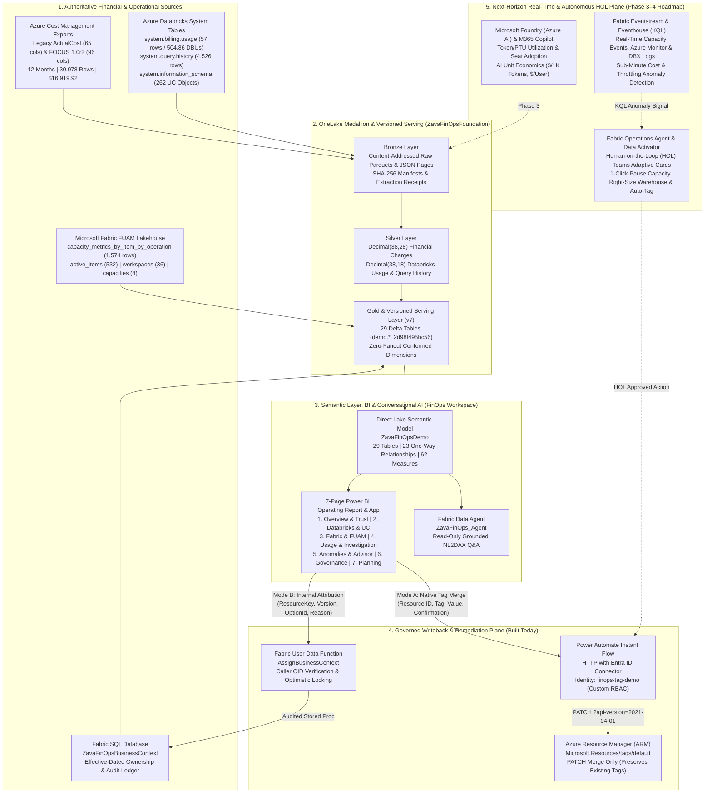

# Zava FinOps & Observability Platform — Executive Leave-Behind & CSA Engagement Charter

**Date:** October 2026  
**Platform Scope:** Microsoft Fabric, Azure Cost Management (FOCUS / ActualCost), Azure Databricks & Unity Catalog, Fabric Unified Admin Monitoring (FUAM), Power BI Direct Lake, Power Automate, and Fabric Data Agent  

---

## 1. Executive Summary

Organizations adopting modern data and AI platforms face a structural FinOps gap: **traditional SaaS cost tools (such as Apptio) operate as external financial ledgers**. They ingest monthly cloud invoices into a proprietary repository, but they cannot see *inside* shared platform capacities (Azure Databricks SQL Warehouses, Unity Catalog assets, or Microsoft Fabric Capacity Units), nor can they close the loop by taking governed remediation action in Azure.

The **Zava FinOps & Observability Platform** demonstrates a **customer-owned, transparent, and actionable alternative built natively on Microsoft Fabric and OneLake**:
1. **Audit-Grade Financial Trust:** 12 closed months of Azure billing (`Oct 2025 – Sep 2026`, **30,078 charge records** across **854 resources**, totaling **`$16,919.9178`** exact source USD / **`$16,919.8317`** 4-decimal model USD) reconciled to **`$0.0000` unexplained variance** via an explicit presentation rounding bridge (`-$0.0861`).
2. **Inside-the-Platform Observability:** Pairs Azure financial truth with live **Databricks System Tables** (`504.86 DBUs`, `4,526 SQL statements`, `262 Unity Catalog assets` across `3 catalogs` and `29 schemas`) and **Microsoft Fabric FUAM Telemetry** (`1,021,021.69 Observed CUs`, `47,530 operations`, `532 active items` across `39 workspaces` and `5 capacity scopes`)—without ever conflating operational units (`DBUs`/`CUs`) with billed dollars (`USD`).
3. **Bi-Directional Governance & Native Tagging:** Eliminates passive "download-to-CSV" workflows by embedding two mutually exclusive, audited writeback paths directly inside the Power BI experience:
   - **Native Azure Resource Tagging** via a report-triggered Power Automate flow executing `PATCH` (`operation: "Merge"`) under a dedicated, least-privilege Entra ID operator (`Zava FinOps Demo Tag Operator`).
   - **Effective-Dated Business Context** via a Fabric User Data Function (`AssignBusinessContext`) backed by Fabric SQL Database with optimistic concurrency and full caller/invocation audit trails.
4. **Proactive Anomaly Detection, Azure Advisor & Grounded AI Assistance:** Surfaces the exact data backing Azure's daily `dailyanomalybyresourcegroup` (`ms:DailyAnomalyByResourceGroup`) email alerts (`1,011 daily RG cost rows` across `33 resource groups`, `4 detected spikes`), `3 Cost Management budget/forecast alerts` (`FDPOAzureBudget`), and `49 Azure Advisor recommendations` (`12 High`, `26 Medium`, `11 Low`), alongside a 3-month rolling-origin backtested forecast (`Oct–Dec 2026`, MAE `$458.70` vs. naive `$498.69`) and a dedicated, read-only **Fabric Data Agent (`ZavaFinOps_Agent`)** grounded on all **29 tables and 62 measures** of the curated Direct Lake semantic model.

---

## 2. Reference Architecture & Data Flow

---

## 3. Data Sources, Grain & Semantic Guardrails

| Domain | Source System & Table | Retained Scope & Volume | Authoritative Grain & Precision | Non-Negotiable Semantic Guardrail |
| :--- | :--- | :--- | :--- | :--- |
| **Cloud Financials** | Azure Cost Exports (`ActualCost 2021-10-01` & `FOCUS 1.0r2`) | Oct 2025 – Sep 2026 (`12 closed months`, `30,078 rows`, `854 resources`) | Charge line item; `Decimal(38,28)` source -> `Decimal(19,4)` model with explicit `Rounding USD` bridge | Never deduplicate charge rows by value; preserve signed credits and `Unassigned` spend (`$11,570.42` / `68.4%`). |
| **Financial Reconciliation** | Native Azure Cost Management Query API | 12 monthly subscription totals | Monthly subscription aggregate (`±$0.0001` tolerance) | Reconciliation measures ignore Business Unit / Resource filters so source truth remains invariant during slice-and-dice. |
| **Databricks Usage & Queries** | `system.billing.usage`, `system.query.history`, `system.compute.warehouses` | May – Jun 2026 (`57 usage rows`, `4,526 query statements`, `11 warehouse SCD rows`) | Daily SKU/Product/Target DBUs (`504.8611 DBUs`) & Daily Warehouse Outcomes (`247 failed`) | Never join `billing.usage` directly to `query.history` (prevents query fan-out from multiplying DBUs); never add DBUs to Azure USD. |
| **Databricks Unity Catalog** | `system.information_schema.tables` & `volumes` | Live workspace snapshot (`259 tables/views`, `3 volumes`, `29 schemas`, `3 catalogs`) | One row per catalog asset (`MANAGED`, `VIEW`, `EXTERNAL` / `DELTA`, `DELTASHARING`) | Provides estate governance context alongside DBU burn; catalog object count does not imply storage cost without volume size telemetry. |
| **Fabric Capacity & Estate** | `FUAM_Lakehouse` (`capacity_metrics_by_item_by_operation_by_day`, `active_items`, `workspaces`, `capacities`) | Aug 17–28, 2026 operations (`1,574 rows`, `1,021,021.69 CUs`, `47,530 ops`); `532 active items` in `39 workspaces` | Unique `Date + Capacity + Workspace + Item + Kind + Operation` grain | Keep Fabric CUs and Databricks DBUs strictly separate via single-select platform controls; do not infer shared-capacity dollar chargeback without an approved allocation policy. |
| **Ownership & Native Tags** | `ZavaFinOpsBusinessContext` SQL DB & ARM `Microsoft.Resources/tags` | `854 resources`, `5,124 editable tag rows`, `5 controlled business options`, `5 audit rows` | Effective-dated resource assignment & live ARM resource tag dictionary | Native Azure tag edits apply forward in Azure and do not retroactively rewrite historical billing exports. |
| **Anomaly Alerts & Advisor** | `Microsoft.CostManagement/scheduledActions` (`dailyanomalybyresourcegroup` / `ms:DailyAnomalyByResourceGroup`), `CostManagement/alerts`, `Microsoft.Advisor/recommendations` | `1,011 daily RG rows` (`33 RGs`, Aug 19 – Oct 20, 2026), `4 detected spikes`, `3 budget alerts`, `49 Advisor recommendations` | Daily `Date + ResourceGroupName` cost vs. 14-day trailing baseline & unified signal grain (`56 insights`) | Keep rolling 60-day anomaly evaluation window (`$2,167.26`) separate from closed 12-month financial ledger (`$16,919.83`). |

---

## 4. Key Architectural Decisions (FinOps Hub, FOCUS, Security & Cost-of-FinOps)

### 4.1 FinOps Hub & FOCUS Alignment vs. Turnkey Assumption
- **Evaluation Outcome:** We evaluated Microsoft **FinOps Toolkit v14 (FinOps Hub)** directly rather than assuming it is a complete replacement for a customer FinOps platform.
- **Why Selective Reuse Wins:** FinOps Hub provisions Azure Data Factory, ADLS Gen2, Event Grid, and optional Data Explorer/Eventhouse pipelines for cost exports. While its **FOCUS 1.0r2 canonical vocabulary** is valuable (and adopted in our financial adapter), FinOps Hub alone does not ingest Databricks `system.*` tables, correlate Unity Catalog/FUAM estate inventories, or provide report-native writeback.
- **Recommended Pattern:** Retain our lightweight, schema-verified OneLake Bronze/Silver/Gold medallion and Direct Lake star schema as the unified serving layer, and optionally plug FinOps Hub export pipelines into the Bronze landing zone during production scale-out.

### 4.2 Least-Privilege Action Security Model
- **Separation of Identities:** The architecture strictly separates **Report Viewer**, **Business Caller**, **Connection Owner**, and **Azure Execution Identity**:
  - **Native Azure Tagging:** Executed through Power Automate using the dedicated Entra ID account `finops-tag-operator@contoso.onmicrosoft.com` bound to custom RBAC role **`Zava FinOps Demo Tag Operator`** (`00000000-0000-0000-0000-000000000015`), which grants *only* `Microsoft.Resources/tags/read` and `Microsoft.Resources/tags/write`—zero compute, data, or delete permissions.
  - **Merge-Only Semantics:** Tag writes use `"operation": "Merge"` so existing unrelated resource tags are preserved and tag deletions are blocked.
  - **Internal Business Context:** Executed via Fabric UDF `AssignBusinessContext`, which validates caller Entra OID/Tenant ID, checks optimistic `ResourceVersion`, enforces a 10–1,000 character business justification, and writes an immutable audit row.

### 4.3 Cost-of-FinOps Guardrails
- **Right-Sized Compute:** The entire FinOps workspace (`FinOps`) runs on an existing **Fabric F4 capacity** (`astoriafabricnorthcentralus`).
- **Single-Executor Spark Jobs & Direct Lake:** Medallion and serving notebooks pin `numExecutors: 1` with `dynamicAllocation: false` and manual-only execution during the demo, while `ZavaFinOpsDemo` uses **Direct Lake on OneLake** (`DirectLakeOnly`) to eliminate redundant Import refresh compute.

---
